<!-- Cards in ./assets are generated by scripts/build_assets.py -->

## 🌐 Socials:

  
  
  

### 👋 Hi there

I'm **Gürkan**, a Full Stack Developer. I build web apps end to end with Next.js, React, Node.js and TypeScript, from the database to the last pixel.

- 🔭 Building **[npoq](https://npoq.net)**, a chatbot, OBS overlay and statistics platform for Kick streamers, used by 100+ active streamers.
- 🎯 Shipped **[ClutchBoard](https://github.com/Gurkankaradag0/ClutchBoard)**, a Valorant stats, match history and live match desktop app built with Tauri, Rust and React.
- 🎮 Made **[Repodle](https://repodle.com)**, a daily guessing game for R.E.P.O. in 3 languages.
- 📫 [contact@gurkankaradag.me](mailto:contact@gurkankaradag.me)

### 💻 Tech Stack

**Languages**

    

**Frontend**

            

**Backend & Realtime**

      

**Databases**

      

**Desktop**

  

**DevOps, Testing & Tools**

      

### 🚀 Featured Projects

  
  

  
  

### 📊 GitHub Stats

<!-- -->
<!-- -->

  

<picture>
  <source media="(prefers-color-scheme: dark)" srcset="https://raw.githubusercontent.com/Gurkankaradag0/Gurkankaradag0/output/github-snake-dark.svg" />
  
</picture>

  

## 💰 You can help me by Donating

